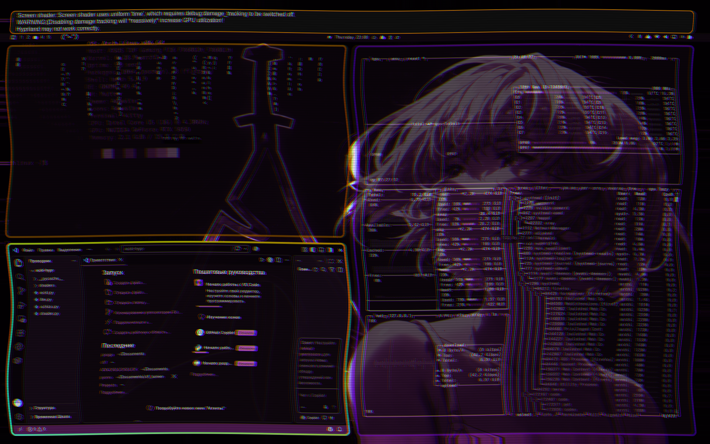
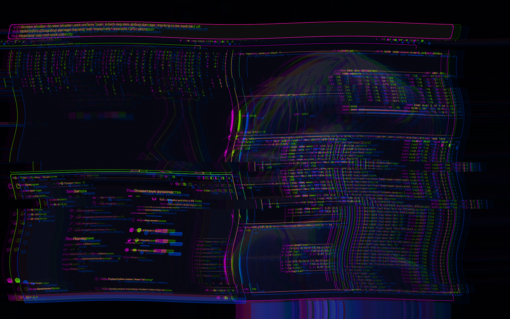
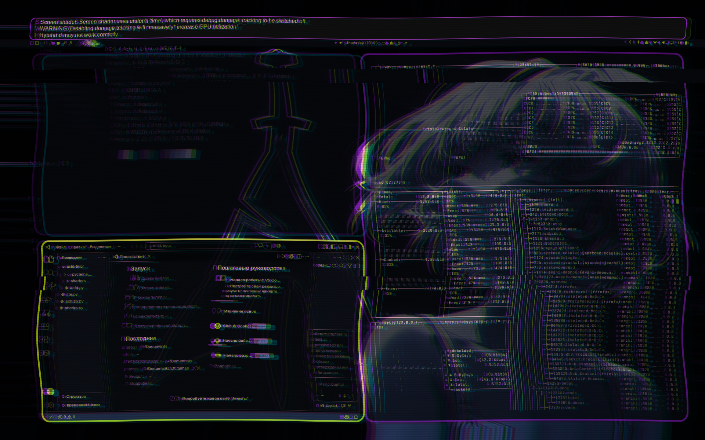
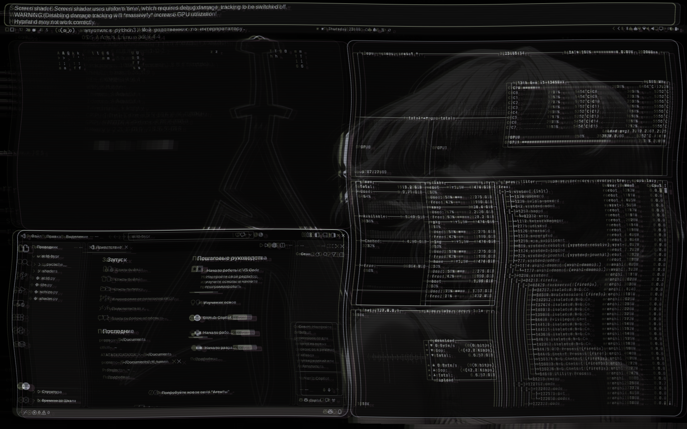
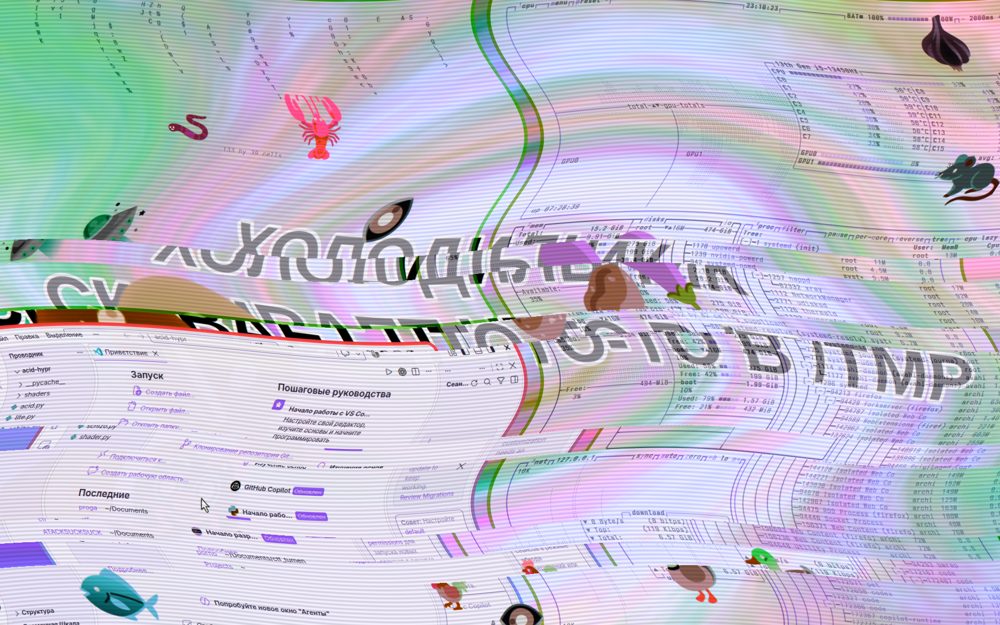
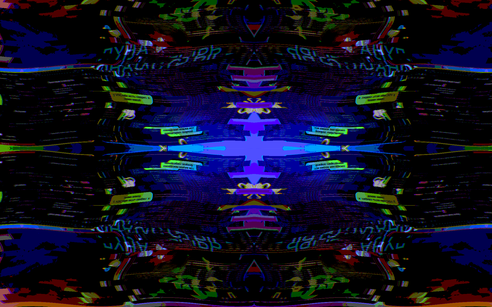
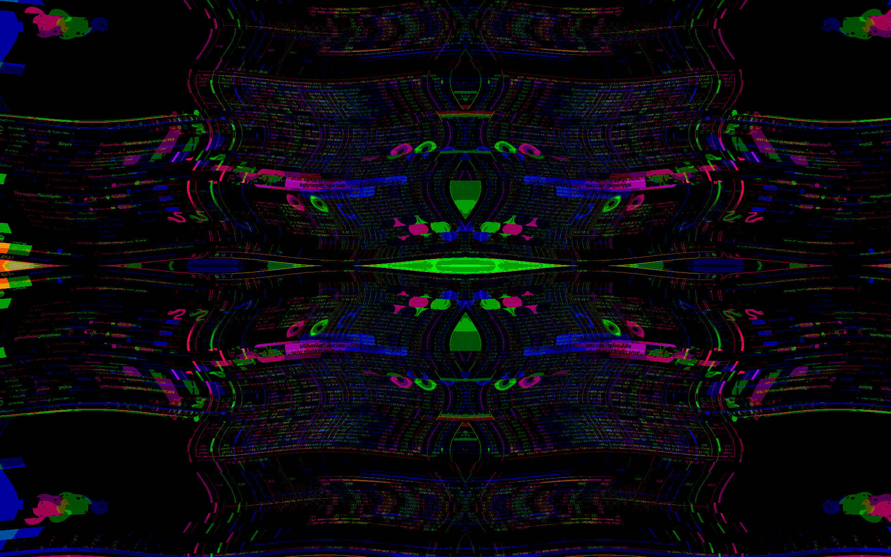
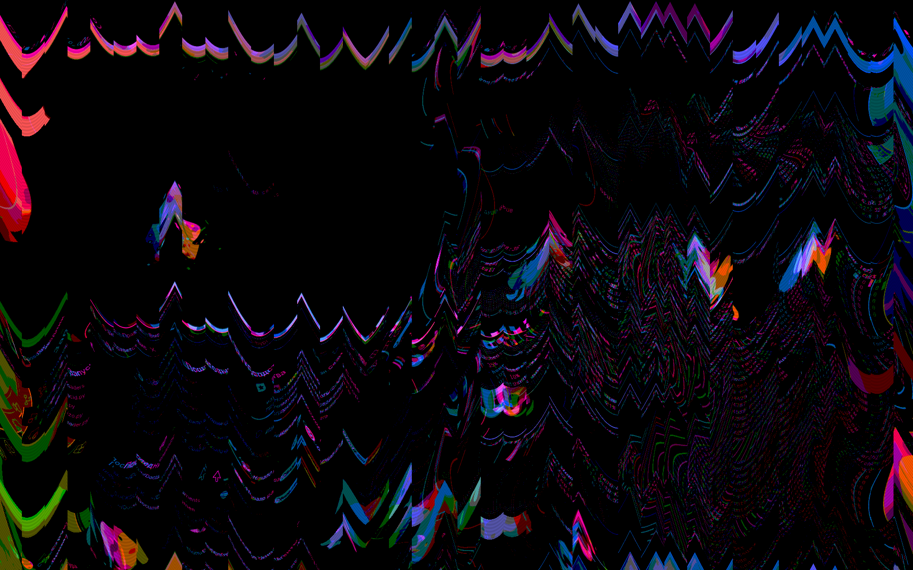

# acid-hypr

Рантайм-эффекты для [Hyprland](https://hyprland.org): рабочий стол дышит, плывёт волной
и переливается цветами — от мягкого «лайта» до полного шизо-режима с тварями и скримерами.

**Ничего не ломает.** Все изменения только в рантайме через `hyprctl` — конфиги не трогаются.
`Ctrl+C` → `hyprctl reload`, и всё возвращается как было.

## Режимы

### Лайтовый — `lite.py`
Мягкая кислота: экран плывёт волной (текст тоже), цвета медленно переливаются, гэпы, рамки
и скругления дышат, у каждого окна своя кислотная рамка. Без инверсий, переворотов и скримеров.

```bash
./lite.py              # обычно
./lite.py --music      # дышит под то, что играет из колонок
./lite.py --wave 2     # плывёт сильнее
./lite.py --no-bursts  # только ровное плавание, без всплесков
```

| | |
|---|---|
|  |  |
|  |  |

### Жёсткий — `schizo.py`
Полный шизо-режим: по углам выскакивают «твари» и несут бред про твою же систему, обои
генерятся на лету (кислотная воронка + абсурдный заголовок), поверх всего работает дыхание
гэпов, скруглений и прозрачности, рамки окон постоянно меняют цвет.

```bash
./schizo.py            # обычная шиза
./schizo.py --music    # шиза под музыку
```

Нужны `python-gobject` и `gtk4-layer-shell` (оверлейные окна тварей).

| | |
|---|---|
|  |  |
|  |  |

### Базовое дыхание — `acid.py`
Только дыхание рабочего стола синусоидой или под музыку (гэпы, рамки, скругления, цвета).
На нём стоят оба режима выше.

```bash
./acid.py              # синусоида
./acid.py --music      # под музыку
./acid.py --speed 3    # быстрее
```

## Как работает

| Файл | Что делает |
|------|-----------|
| `acid.py`   | дышащие гэпы/рамки/скругления/цвета через `hyprctl eval`; захват звука через `parec` |
| `lite.py`   | то же + полноэкранный GLSL-шейдер волны и переливов |
| `schizo.py` | GTK4-оверлеи («твари»), генерация обоев на лету, кислотные рамки поверх `acid` |
| `shader.py` | генератор GLSL-шейдеров на весь экран |

## Требования

- Hyprland
- Python 3 (`acid.py`, `lite.py` — только stdlib)
- `python-gobject`, `gtk4-layer-shell` — для `schizo.py`
- `pipewire-pulse` / `pulseaudio` (`parec`) — для режима `--music`

## Осторожно

Жёсткий режим содержит мигания, резкие вспышки и скримеры — не стоит запускать при
фоточувствительной эпилепсии. Всё откатывается по `Ctrl+C`.

## Лицензия

MIT — см. [LICENSE](LICENSE).
